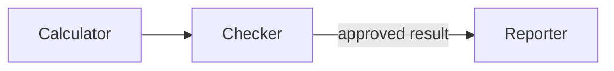

# Orientation: Transforming Meaning

An application built around a language model depends on the work the model can perform with the information it receives. A relationship recognized in one example may be useful in another setting. Carrying it across requires an account of what remains valid and where the correspondence ends.

Such changes are cognitive transformations: ways of working with meaning by changing how a situation is represented or approached. The central question is how these changes can produce a useful result while preserving a logical and coherent account. That gives us a practical basis for specifying the work assigned to a model.

The Cognitive Skills Framework organizes examples of this work into reusable methods. This orientation examines the underlying transformations through simple cases whose relationships and limits remain visible. The resulting distinctions provide a basis for assessing the repository's modules and developing other arrangements suited to a particular application.

## 1. Analogy

Doubling every side of a triangle enlarges the figure while preserving its angles and proportions. Applying the same operation to a square produces a corresponding relationship between the original and enlarged figures. The figures differ, but both undergo enlargement that preserves shape.  Moreover, it should be noted that analogies allow properties of the object to be preserved, such as the sum of interior angles properties, Euclidean definition of the triangle, the area and circumference formulas.  None of these change, merely the size of the object itself.

This is a simple instance of **analogy**. The correspondence concerns the operation and the relationship it preserves. Recognizing that relationship allows an idea developed in one case to become useful in another.

The correspondence has a definite scope. A square with sides of one unit becomes a square with sides of two units. Four of the original unit squares fit inside it. Length doubles; area becomes four times as large.

The transferable rule is therefore **double the lengths**. Extending it to **double every property** would introduce a claim the example does not support. The same picture establishes both the relationship and the boundary of the inference.  Basic formula descriptions of the object remain the same.  Analogical vector embedding mathematics is straightforward for an AI model.

## 2. Metaphor and correspondence

“The table of contents is a map of the book” presents a document through a familiar relationship. A map locates places; a table of contents locates topics. Both provide an overview that can guide a more detailed inquiry.

This is **metaphor**: one thing is presented through an image drawn from another. The image makes a selected correspondence prominent without spelling out every part of the comparison.

For document design, the correspondence concerns orientation. A table of contents indicates where an explanation appears and how sections relate within the book. Its usefulness in locating an argument does not establish the argument's correctness. The image carries a navigational relationship, with a clear limit on what that relationship warrants. One object is meant to represent the properties of another, although on the surface the two objects are seemingly unrelated.  Metaphors work best when the property under discussion between the two seemingly unrelated items is highlighted.  Modern LLM's do this transformation quite readily.

Analogy can develop a correspondence explicitly across cases. Metaphor can concentrate it into a way of seeing a case. In either form, the correspondence provides something more precise to work with than a general impression of similarity. A model can help recover that structure and assess whether it remains relevant in a proposed application.

## 3. Viewpoint and dimensionality

A triangular prism with rectangular side faces presents different outlines from different positions. Viewed directly from one end, its outline is a triangle. Viewed squarely from one rectangular side, its outline is a rectangle. The solid remains the same while the view changes.

The prism gives a concrete image for **rotation of a conceptual view**: the subject remains fixed while another of its relationships becomes prominent. A proposed action, for example, can be described through what it requires or through what it produces. The descriptions emphasize different relationships within the same action.

A triangular outline leaves much of the solid unseen. Similarly, a description can be accurate about the view it presents while leaving other consequential relationships outside its scope. Changing viewpoint can recover some of that information without changing the underlying subject.

An omitted dimension creates a different problem. Two roads may cross on a flat map while a traveler reports that they do not meet. This inconsistency may be viewed as a paradox.  However, height offers a possible reconciliation: one road passes over the other on a bridge. The projected lines cross, while the roads remain separate in space.

This is **dimensional lift**. An additional dimension makes an apparent conflict between observations understandable while retaining both observations.

The map alone does not establish that a bridge exists. Height supplies a possible explanation whose applicability still depends on evidence about the roads. The distinction clarifies the inquiry without settling the missing fact.

## 4. Abstraction, detail, and salience

A subway map can straighten a curved track and spread crowded stations farther apart while retaining the connections needed to plan a journey. A short section might be represented as:

> Oak — Park — River

Replacing the names with letters gives:

> A — B — C

The pattern can then be described as three nodes joined in a line. Station names and geographical appearance have been set aside; the connections remain.

This is **abstraction**: a selected relationship is retained in a description with fewer particulars. The resulting pattern is easier to recognize in another instance because its identity no longer depends on those particular station names. For abstraction, a model can highlight a connection between two items without requiring the consideration of the pathway or intervening items between them.

The pattern supplies no walking distances. Equal line lengths on the page need not represent equally long journeys. Its usefulness depends on the relationship selected for preservation—here, connectivity.

**Concretization** moves back toward particulars. The three-node pattern can be assigned actual stations and services to produce a specified instance. The pattern alone cannot determine those assignments. However if one were to walk from one station to the other, then an abstraction map is no longer useful.  One will need the intervening details such as landmarks, street signs, and such to walk from one station to another.  Station names and location information will also have to be supplied, introducing evidence or choices that the abstraction map omitted.

A model can support both movements: extract a connection pattern from a described network, then construct an instance using supplied details. The practical question is whether the selected relationships survive the movement between cases.

**Salience** can change even when the particulars remain fixed. Two routes may have the following properties:

| Route | Travel time | Transfers |
|---|---:|---:|
| A | 10 minutes | 2 |
| B | 15 minutes | 0 |

Giving time the greatest importance favors A. Giving the avoidance of transfers the greatest importance favors B. The routes and measurements remain unchanged; their relative importance changes.

This is **salience reweighting**. Existing features receive different priority within a comparison, changing the basis of preference. Increasing the importance of transfers does not reduce Route B's travel time to ten minutes. The changed preference remains accountable to the same supplied facts.

## 5. Behavior labels and their supporting actions

“The assistant checks a sum” compresses several possible actions into a **behavior label**. In a specified checking task, the assistant receives two numbers and a stated answer, calculates the total, compares the results, and reports whether they agree. Its role is to check the supplied calculation under those conditions.  The label represents the assistant and his role, not the actual task itself.

Making the actor, actions, role, and conditions explicit is **label decomposition**. It replaces a compact claim with an arrangement that can be examined.

For a system designer, the resulting questions concern the information received, the comparison performed, and the meaning of the report. Those details determine what the checking function amounts to in this application.

The description label of "assistant" does not establish that he performed the stated actions. It specifies the claimed behavior closely enough for that claim to be assessed. If the quality of his work were to be reviewed, then his role may be decomposed for inspection.  A model can help produce this account without the account itself becoming evidence of implementation.

## 6. Conditions and purposes

A route through a gate is available when the gate is open. When the gate is closed, the same line on the map no longer describes an available passage. The route, traveler, and intended journey can remain the same while the gate's state changes what is possible.

This dependence illustrates a **regime change**. A conclusion applies under particular operating conditions; changing those conditions can change its applicability.

A model can make the dependence explicit in a recommendation: the route is available when the gate is open. The map cannot establish the gate's present state, so the recommendation identifies a condition that still needs to be checked.

A requirement raises a separate issue: the relationship between a purpose and a chosen means. Holding a sheet of paper down with a weight serves the purpose of keeping it from blowing away. A clip that fastens the paper to a fixed board offers another means of keeping it in place.

Replacing the required means while retaining the stated purpose is **constraint substitution**. The purpose supplies the basis for comparing the alternatives.

An additional requirement can change that comparison. If the paper must remain unmarked, a clip that leaves a mark fails even if it holds the sheet securely. The alternative has to preserve the requirements that actually govern the task.

Regime change concerns what happens under another condition, i.e. changing the condition may yield a different results. Constraint substitution concerns whether a different constraint can still yield the same result. The distinction allows a proposed change to be examined without losing the purpose it was meant to serve.

## 7. Time and order

An automatic door's normal cycle has successive phases:

> Opening → held open → closing

During opening, the gap grows. While the door is held open, the gap stays at its open position. During closing, it narrows. The behavior varies within one ordered event.

**Temporal phase decomposition** separates those parts while retaining their order. It supports an account of a process whose behavior changes as the process develops.

The phase names supply no durations. Timing requires further information. The decomposition organizes the event while leaving that property unspecified.

Order can also change a result when the operation set remains fixed. For the list `3, 1, 5`, two operations—sorting in descending order and retaining the first two numbers—produce different results in different sequences.

Sorting first gives:

> 3, 1, 5 → 5, 3, 1 → **5, 3**

Retaining two first gives:

> 3, 1, 5 → 3, 1 → **3, 1**

The first sequence sorts all three numbers before discarding one. The second discards the 5 before sorting begins. Sorting cannot recover a value already removed.

This is **operator sequence reordering**: the same actions are arranged differently, and their dependencies determine the effect. A model can compare candidate sequences by tracing what each action makes available to the next. The relevant constraint is visible in the intermediate states, including any information lost along the way.

## 8. Deliberate intervention

A small program with the rule `y = 2x + s` provides a direct example of intervention. Suppose `x` normally comes from a sensor. Bypassing that input and setting `x` directly changes how its value is determined.

With `s` held at 3, setting `x` to 1 gives `y = 5`; setting `x` to 2 gives `y = 7`. The rule and `s` remain fixed. The output is allowed to vary because its response to the intervention is the property under examination.

This illustrates **counterfactual intervention**: deliberately set part of a system differently and follow the consequences, instead of accepting the value its ordinary source would supply.

The results here follow from the stipulated formula. They provide no measurement of what a real sensor will report. A model can reason through the stated intervention while retaining the distinction between a consequence of the supplied rule and evidence about an external system.

## 9. Connections and roles

A calculation workflow may require a result to be checked before it is reported. Three components are sufficient to describe the relevant arrangement:

> Calculator, checker, reporter

If the calculator sends its result directly to the reporter and a copy to the checker, reporting can begin before checking finishes. Reconnecting the components places the check on the reporting path:

The components remain fixed while their connections change. This is **topological rewiring**. The revised path expresses a dependency: the reporter receives the result through approval.

That dependency still needs to be enforced by the implementation. A diagram describes the intended route; it does not establish that the program requires an approved result.

Role assignment changes a different part of an arrangement. In a task where checking means comparison with an official answer key, suppose only Pat can consult the key. Assigning Sam to answer and Pat to check makes use of that access. Exchanging their roles while leaving access unchanged puts Sam in the checking role without its required resource.

This is **actor–role rebinding**. The available actors remain; their assignments change. A reassignment therefore has to account for what each actor can actually know or do. Responsibility alone does not transfer access to the key.

Rewiring changes connections between components. Rebinding changes who occupies a role. Both can alter a system's behavior, but they imply different implementation changes. A model can help distinguish them when developing or comparing candidate arrangements.

## 10. Compatibility between requirements

One person needs quiet to read; another needs conversation to rehearse. With one room available, the two activities conflict if they must occur together.

Flexible timing creates another arrangement. Separate quiet and conversation periods may meet both requirements. The participants and their needs remain distinct, while the conditions of room use change.

This is a **relationship rebase**: an arrangement is revised so that consequential requirements can relate differently. In this case, the change concerns operating conditions, making it a regime-focused rebase.

Its applicability depends on timing. If both people must use the room at noon, separate periods have not resolved the conflict. A useful model response retains that result as an unresolved requirement, rather than treating the existence of an imaginable schedule as agreement.

## 11. Challenges to claims and arrangements

The claim that every four-sided figure with four equal sides is a square has a straightforward counterexample. A rhombus with angles of sixty and one hundred twenty degrees has four equal sides without having right angles. It satisfies the premise and defeats the conclusion.

This is **falsifier search**. The proposed countercase has to preserve the conditions of the claim while violating its conclusion. A square rotated on the page would not qualify because its angles remain right angles. A changed appearance alone does not establish the relevant difference.

A model can propose counterexamples and explain why they qualify. The proposed cases remain open to inspection, and failure to find one is not itself a proof of the claim.

An arrangement invites a broader challenge. In the proposed room schedule, conversation might continue after the quiet period is meant to begin. The arrangement then needs some way of restoring the promised quiet.

Developing that branch is **adversarial verification**: a consequential challenge is constructed against a candidate arrangement so that its response can be examined.

In this example, the quiet period overrun remains hypothetical. Testing the state of that period lies in exposing that the arrangement was satisfied, rather than assuming that the quiet state will occur. A model can make the challenge precise enough to inform a decision or a test.

## 12. Organizing assumptions and alternative routes

Repeatedly searching a book from its first page can frame the problem as a need to read faster. Proposed improvements may then retain the assumption that starting at the beginning is necessary.

If review identifies that assumption as the obstacle, temporarily suspending it opens another route while preserving the objective: locating the topic. An index becomes a candidate.

The candidate still has to be reconstructed against the actual book and search. The topic must be indexed, and the entries must lead to the relevant passages. An index cannot locate a topic it does not list.

This illustrates **anchor suspension followed by reconstitution**. An organizing assumption is relaxed, another route is explored, and the proposal is brought back to the objective and its requirements.

The return gives the departure its practical significance. An index serves this search when its entries meet the need. An alternative that cannot meet the objective remains a possibility to develop rather than a completed solution.

## 13. Application design

The transformations considered here act on different aspects of a representation: relationships carried between cases, viewpoints, levels of detail, conditions, sequences, connections, and responsibilities. Each exposes a particular kind of change and the properties that need to survive it.

These distinctions support concrete requests to a language model: carry a relation into another case; describe another view while retaining the facts; identify a missing condition; compare orders; find a counterexample; or preserve distinct requirements while exploring another arrangement.

This book uses **native** for a transformation the model can carry out through learned capacities without the application implementing that transformation's algorithm separately. The application remains responsible for supplying relevant material, preserving requirements, and assessing whether the result serves its purpose.

The names describe work that can be requested and examined. They establish neither a particular internal mechanism nor a fixed number of independent faculties. Several transformations may contribute to one answer. Reliability can vary among models, especially as a task becomes longer or less familiar.

Information for the work can come from training, supplied context, or retrieved material. A model can also infer consequences and propose alternatives. The formula above supports consequences that follow from a supplied rule. The bridge and index are proposals whose applicability depends on further information. Their different status affects what an application can conclude and what it needs to obtain next.

The repository's modules organize examples of this work. O/D/R/O makes the represented situation explicit. KCE helps identify a relation that may be reusable. Exploration, comparison, and oversight modules offer further arrangements for particular needs. The underlying transformations provide a basis for selecting, combining, or developing approaches suited to an application.

[O/D/R/O](../ODRO.md) develops the next issue: representing a situation so that its important relationships can survive a transformation.

## Reference: examples and registry

The [current CTR registry](../../framework/CTR_Parallax_v2.1_SplitTransformRegistry.json) names 55 operators in 16 families. The table maps one representative entry from each family to the examples above. Analogy and metaphor establish the opening correspondences; they are not separate named entries in this registry.

| Family | Representative operation | Example |
|---|---|---|
| Symmetry | `CTR_SYM_ROTATE_001` — rotation | Different outlines of the same prism. |
| Abstraction ladder | `CTR_ABS_LIFT_001` — abstraction lift | Stations and connections become nodes and links. |
| Label decomposition | `CTR_LABEL_DECOMP_001` — computed label decomposition | Unpack what checking a sum entails in the specified task. |
| Deformation | `CTR_DEF_SALIENCE_001` — salience reweighting | Give time or transfers greater importance. |
| Constraint isolation | `CTR_CON_SUB_001` — constraint substitution | Replace the paperweight with a clip while retaining the purpose. |
| Regime transformation | `CTR_REG_SHIFT_001` — regime shift | A route depends on whether its gate is open. |
| Dimensional | `CTR_DIM_LIFT_001` — dimensional lift | Add height to distinguish a crossing from a junction. |
| Temporal phase | `CTR_TEMP_PHASE_DECOMP_001` — phase decomposition | Opening, held open, closing within one door cycle. |
| Counterfactual intervention | `CTR_CAUS_DO_001` — do intervention | Set an input deliberately under the supplied formula. |
| Negation/falsifier | `CTR_NEG_FALSIFY_001` — falsifier search | An equal-sided rhombus without right angles. |
| Topology | `CTR_TOP_REWIRE_001` — edge rewiring | Put the existing checker on the reporting path. |
| Dynamical core | `CTR_DYN_SEQUENCE_001` — operator sequence reordering | Sort before discarding, or discard before sorting. |
| Coupling | `CTR_COUPLE_REBIND_001` — actor–role rebinding | Exchange answering and checking roles while the key stays with its holder. |
| Relationship rebase | `CTR_REL_REGIME_CONFLICT_001` — regime conflict rebase | Separate room-use periods when timing permits. |
| Adversarial verification | `CTR_ADV_REDTEAM_001` — red-team branch | Conversation overruns into the quiet period. |
| Discontinuous reconstitution | `CTR_DISC_ANCHOR_SUSPEND_001` — anchor suspension | Set aside a trapping assumption about searching from page one, then examine whether an index meets the goal. |

The registry's invocation and verification requirements remain part of applying its workflows. Ordered-path validation is assigned to CEC, relationship rebases route to CREM, and anchor suspension requires DARE authorization and supervision. Returnability may be deferred during a discontinuous departure, but a coherent return must be reconstructed and reviewed by CEC; otherwise the candidate remains speculative. These examples illustrate representative transformations and do not imply execution of those workflows. The [module index](../MODULES.md) supplies the detailed reference route.
