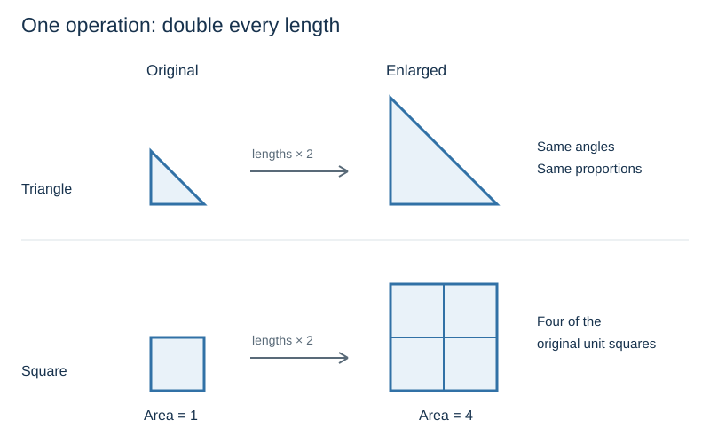

# Orientation: Transforming Meaning

An application built around a language model depends on the work the model can perform with the information it receives. A relationship recognized in one example may be useful in another setting. Carrying it across requires an account of what remains valid and where the correspondence ends.

Such changes are cognitive transformations: ways of working with meaning by changing how a situation is represented or approached. The central question is how these changes can produce a useful result while preserving a logical and coherent account. That gives us a practical basis for specifying the work assigned to a model.

The Cognitive Skills Framework organizes examples of this work into reusable methods. This orientation examines the underlying transformations through simple cases whose relationships and limits remain visible. The resulting distinctions provide a basis for assessing the repository's modules and developing other arrangements suited to a particular application.

## 1. Analogy

Doubling every side of a triangle enlarges the figure while preserving its angles and proportions. Applying the same operation to a square produces a corresponding relationship between the original and enlarged figures. The figures differ, but both undergo enlargement that preserves shape.  The triangle remains a triangle and the square remains a square. Their perimeter and area formulas remain the same, although the values calculated from their respective formulas change with the change in the length of the edges.

This is a simple instance of **analogy**. The correspondence concerns the operation and the relationship it preserves. Recognizing that relationship allows an idea developed in one case to become useful in another.

The correspondence has a definite scope. A square with sides of one unit becomes a square with sides of two units. Four of the original unit squares fit inside it. Length doubles; area becomes four times as large.

The transferable rule is therefore **double the lengths**. Extending it to **double every property** would introduce a claim the example does not support. The same picture establishes both the relationship and the boundary of the inference.

## 2. Metaphor and correspondence

“The table of contents is a map of the book” presents a document through a familiar relationship. A map locates places; a table of contents locates topics. Both provide an overview that can guide a more detailed inquiry.

This is **metaphor**: one thing is presented through an image drawn from another. The image makes a selected correspondence prominent without spelling out every part of the comparison.

For document design, the correspondence concerns orientation. A table of contents indicates where an explanation appears and how sections relate within the book. Its usefulness in locating an argument does not establish the argument's correctness. The image carries a navigational relationship, with a clear limit on what that relationship warrants. One object is meant to represent the properties of another, although on the surface the two objects are seemingly unrelated.  Metaphors work best when the property under discussion between the two seemingly unrelated items is highlighted.  Modern LLM's do this transformation quite readily.

Analogy can develop a correspondence explicitly across cases. Metaphor can concentrate it into a way of seeing a case. In either form, the correspondence provides something more precise to work with than a general impression of similarity. A model can help recover that structure and assess whether it remains relevant in a proposed application.

## 3. Viewpoint and dimensionality

A triangular prism with rectangular side faces presents different outlines from different positions. Viewed directly from one end, its outline is a triangle. Viewed squarely from one rectangular side, its outline is a rectangle. The solid remains the same while the view changes.

The prism gives a concrete image for **rotation of a conceptual view**: the subject remains fixed while another of its relationships becomes prominent. A proposed action, for example, can be described through what it requires or through what it produces. The descriptions emphasize different relationships within the same action.

A triangular outline leaves much of the solid unseen. Similarly, a description can be accurate about the view it presents while leaving other consequential relationships outside its scope. Changing viewpoint can recover some of that information without changing the underlying subject.

An omitted dimension creates a different problem. Two roads may cross on a flat map while a traveler reports that they do not meet. This inconsistency may be viewed as a paradox.  However, height offers a possible reconciliation: one road passes over the other on a bridge. The projected lines cross, while the roads remain separate in space.

This is **dimensional lift**. An additional dimension makes an apparent conflict between observations understandable while retaining both observations.

The map alone does not establish that a bridge exists. Height supplies a possible explanation whose applicability still depends on evidence about the roads. The distinction clarifies the inquiry without settling the missing fact.

## 4. Abstraction, detail, and salience

A subway map can straighten a curved track and spread crowded stations farther apart while retaining the connections needed to plan a journey. A short section might be represented as:

> Oak — Park — River

Replacing the names with letters gives:

> A — B — C

The pattern can then be described as three nodes joined in a line. Station names and geographical appearance have been set aside; the connections remain.

This is **abstraction**: a selected relationship is retained in a description with fewer particulars. The resulting pattern is easier to recognize in another instance because its identity no longer depends on those particular station names. For abstraction, a model can highlight a connection between two items without requiring the consideration of the pathway or intervening items between them.

The pattern supplies no walking distances. Equal line lengths on the page need not represent equally long journeys. Its usefulness depends on the relationship selected for preservation—here, connectivity.

**Concretization** moves back toward particulars. The three-node pattern can be assigned actual stations and services to produce a specified instance. The pattern alone cannot determine those assignments. However if one were to walk from one station to the other, then an abstraction map is no longer useful.  One will need the intervening details such as landmarks, street signs, and such to walk from one station to another.  Station names and location information will also have to be supplied, introducing evidence or choices that the abstraction map omitted.

A model can support both movements: extract a connection pattern from a described network, then construct an instance using supplied details. The practical question is whether the selected relationships survive the movement between cases.

**Salience** can change even when the particulars remain fixed. Two routes may have the following properties:

| Route | Travel time | Transfers |
|---|---:|---:|
| A | 10 minutes | 2 |
| B | 15 minutes | 0 |

Giving time the greatest importance favors A. Giving the avoidance of transfers the greatest importance favors B. The routes and measurements remain unchanged; their relative importance changes.

This is **salience reweighting**. Existing features receive different priority within a comparison, changing the basis of preference. Increasing the importance of transfers does not reduce Route B's travel time to ten minutes. The changed preference remains accountable to the same supplied facts.

## 5. Inversion and reversibility

The enlargement example also gives us a simple inversion. Doubling the dimensions of a triangle moves from the smaller figure to the larger one. Halving those dimensions moves in the opposite direction.

**Inversion** reverses a direction, polarity, or relationship. Here, enlargement becomes reduction while the shape is preserved. In the registry, inversion sits alongside rotation within the symmetry family.

**Reversibility** asks whether the original can be recovered. Doubling and then halving the dimensions restores the original triangle. Squaring a number presents a different case: both `3` and `−3` give `9`. Recovering the starting value requires its sign or a restriction on the possible inputs.

The distinction gives inversion a useful question to carry with it: what information or conditions make the return possible? Reversing a proposed relationship can open an inquiry without establishing that the reversed claim is true.

These examples provide a small foundation for the discussion that follows. They are ways of recognizing and describing useful changes in meaning; the grouping makes no claim to identify the model's irreducible faculties.

[Next: Working with transformations](02_WORKING_WITH_TRANSFORMATIONS.md) develops further operations and shows how they can be combined around a purpose.
