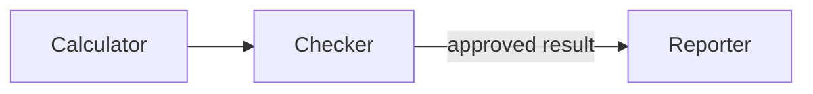

# Compound Transformations

[Introduction: Overview and Basics](01_OVERVIEW_AND_BASICS.md) introduced several broad ways of working with basic transformations. A useful method usually involves a combination of such moves around a particular idea. Establishing what must be preserved, changing part of an arrangement, and examining the consequences can form one connected inquiry.

The examples here extend that repertoire and make its organization visible. Some introduce a further operation; others show several operations working together. Their placement in this chapter does not make every operation compounded, nor does it make the preceding chapter an exhaustive list of primitives.

A recurring set of combinations deserves a name or a separate explanation when commonly invoked. Likewise, the repository's complex cognitive tool sets provide examples of a series of compounded arrangements useful for particular functions. Their complexity depends on the relationships they coordinate, the conditions they retain, and the points at which an earlier choice may need to be revisited.

## 1. Behavior labels and their supporting actions

“The assistant checks a sum” compresses several possible actions into a **behavior label**. In a specified checking task, the assistant receives two numbers and a stated answer, calculates the total, compares the results, and reports whether they agree. Its role is to check the supplied calculation under those conditions.  The label represents the assistant and his role, not the actual task itself.

Making the actor, actions, role, and conditions explicit is **label decomposition**. It replaces a compact claim with an arrangement that can be examined.

For a system designer, the resulting questions concern the information received, the comparison performed, and the meaning of the report. Those details determine what the checking function amounts to in this application.

The description label of "assistant" does not establish that he performed the stated actions. It specifies the claimed behavior closely enough for that claim to be assessed. If the quality of his work were to be reviewed, then his role may be decomposed for inspection.  A model can help produce this account without the account itself becoming evidence of implementation.  This would be analogous to the name of a subroutine as opposed to the function of the module itself.

The contributing moves begin with *abstraction*: separating a role from the person or program assigned to perform it. *Decomposition* separates that function into actions, and concretization supplies their inputs and conditions. *Comparison* then relates the computed total to the stated answer. Together, these moves turn a compact role description into an inspectable account of what the role requires.

## 2. Conditions and purposes

A route through a gate is available when the gate is open allowing access through a certain path. When the gate is closed, the same line on the map is no longer available for passage. The route, traveler, and intended journey can remain the same while the gate's state affects what is permissible.

This dependence illustrates a **regime change**.  A particular idea may be applicable under one set of operating conditions, but no longer available under a different one.

A model can make the dependence explicit in a recommendation: the route is available when the gate is open.  However, the map cannot establish the gate's present state, so the recommendation identifies a condition that still needs to be checked.

A non-negotiable requirement raises a separate issue: the relationship between a requirement and potential options. For example, holding a sheet of paper down with a weight serves the purpose of keeping it from blowing away. A thumb tack may also be used to fasten the paper to a cork board as another means of keeping it in place.

Replacing the required means while retaining the stated purpose is **constraint substitution**. The purpose supplies the basis for comparing the alternatives.

An additional requirement can change that comparison. If the paper must remain undamaged, a tack that leaves a hole fails as an option even if it holds the sheet securely. The alternative has to preserve the fixed requirements that actually govern the task, such as choosing a paper weight, instead.

**Regime change** concerns what happens under another condition, i.e. changing the condition may yield different results. **Constraint substitution** concerns whether a different constraint can still yield the same result. The distinction allows a proposed change to be examined without losing the purpose it was meant to serve.

Both examples hold part of a situation steady while varying another. For the gate, *abstraction* isolates the condition of passage; *comparison* shows what opening and closing change. For the paper, *abstraction* identifies the purpose; *analogy* suggests another means with a related holding function; and *concretization* supplies the thumbtack-and-corkboard arrangement. *Evaluation* checks whether that arrangement preserves the requirements. These combinations let us distinguish a change in what is possible from a change in how the same purpose is served.

## 3. Time and order

An automatic door's normal cycle has successive phases:

> Opening → held open → closing

During opening, the gap grows. While the door is held open, the gap stays at its open position. During closing, it narrows. The behavior varies within one ordered event.

**Phase decomposition** separates those parts while retaining their order. It supports an account of a process whose behavior changes as the process develops.

For this compound transformation, phase denotes sequence rather than timing. Timing requires further information. The decomposition organizes the event while leaving that property unspecified.

Order can also change a result when the operation set remains fixed. For example, the list `3, 1, 5`, and two operations:  sorting in descending order and retaining the first two numbers.  Executing the operations in different order produces different results.

Sorting first gives:

> 3, 1, 5 → 5, 3, 1 → **5, 3**

Retaining two first gives:

> 3, 1, 5 → 3, 1 → **3, 1**

The first sequence sorts all three numbers before discarding one. The second discards the 5 before sorting begins. Sorting cannot recover a value already removed.

This is **operator sequence reordering**: the same actions are arranged differently, and their dependencies determine the effect. A model can compare candidate sequences by tracing what each action makes available to the next. The relevant constraint is visible in the intermediate states, including any information lost along the way.

*Decomposition* separates the door cycle into phases, *abstraction* identifies the characteristic change within each phase, and *sequencing* retains their before-and-after relationships. In the sorting example, *recombination* changes the order while holding the operations fixed.  What remains available after each step is inferred.  The difference between the results can be compared. Combining these moves adds an **account of dependence** to a description of events. We can explain why a later action is affected by what an earlier one preserved or discarded.

## 4. Deliberate intervention

A small program with the rule `y = 2x + s` provides a direct example of intervention. Suppose `x` normally comes from a sensor. Bypassing that input and setting `x` directly changes how its value is determined.

With `s` held at 3, setting `x` to 1 gives `y = 5`; setting `x` to 2 gives `y = 7`. The rule and `s` remain fixed. The output is allowed to vary because its response to the intervention is the property under examination.

This illustrates **counterfactual intervention**: deliberately setting part of a system differently and following the consequences, instead of accepting the value its ordinary source would supply.

The results here follow from the stipulated formula. They provide no measurement of what a real sensor will report. A model can reason through the stated intervention while retaining the distinction between a consequence of the supplied rule and evidence about an external system.

In the sensor example, *abstraction* isolates the input whose effect matters. *Substitution* replaces the sensor-supplied value with a chosen one, inference applies the stated rule, and comparison relates the resulting outputs. Holding the rule and the other input fixed makes the difference traceable to the selected change. This combined operation lets us examine a chosen variation while preserving the surrounding conditions needed to interpret its consequence.

## 5. Connections and roles

A calculation workflow may require a result to be checked before it is reported. Three components are sufficient to describe the relevant arrangement:

> Calculator, checker, reporter

If the calculator sends its result directly to the reporter and a copy to the checker, reporting can begin before checking finishes. Reconnecting the components places the check on the reporting path:

The components remain fixed while their connections change. This is **topological rewiring**. The revised path expresses a dependency: the reporter receives the result through approval.

That dependency still needs to be enforced by the implementation. A diagram describes the intended route; it does not establish that the program requires an approved result.

Role assignment changes a different part of an arrangement. In a task where checking means comparison with an official answer key, suppose only Pat can consult the key. Assigning Sam to answer and Pat to check makes use of that access. Exchanging their roles while leaving access unchanged puts Sam in the checking role without its required resource.

This is **actor–role rebinding**. The available actors remain; their assignments change. A reassignment therefore has to account for what each actor can actually know or do. Responsibility alone does not transfer access to the key.

Rewiring changes connections between components. Rebinding changes who occupies a role. Both can alter a system's behavior, but they imply different implementation changes. A model can help distinguish them when developing or comparing candidate arrangements.

*Abstraction* separates a component's identity from its connections, and an actor's identity from the role assigned. *Recombination* rearranges the existing connections; in the role-exchange example, *inversion* supplies the simple swap between assignments. *Concretization* specifies the resulting arrangement, and evaluation checks its ordering and access requirements. The added capability is to change an organization while retaining an account of its parts, so that altered dependencies and missing resources become visible.

## 6. Compatibility between requirements

One person needs quiet to read; another needs conversation to rehearse. With one room available, the two activities conflict if they must occur together.

Flexible timing creates another arrangement. Separate quiet and conversation periods may meet both requirements. The participants and their needs remain distinct, while the conditions of room use change.

This is a **relationship rebase**: an arrangement is revised so that consequential requirements can relate differently. In this case, the change concerns operating conditions, making it a regime-focused rebase.

Its applicability depends on timing. If both people must use the room at noon, separate periods have not resolved the conflict. A useful model response retains that result as an unresolved requirement, rather than treating the existence of an imaginable schedule as agreement.

*Abstraction* identifies the requirements that each person needs preserved. A change of viewpoint moves attention from choosing between the people to organizing their use of the room. *Decomposition* separates that use into periods, *concretization* supplies a schedule, and evaluation checks it against the timing requirements. Their combination allows distinct aims to remain in view while the arrangement between them changes. This is the additional work of the rebase: the relationship becomes adjustable without requiring either aim to disappear.

## 7. Challenges to claims and arrangements

The claim that every four-sided figure with four equal sides is a square has a straightforward counterexample. A rhombus with angles of sixty and one hundred twenty degrees has four equal sides without having right angles. It satisfies the premise and defeats the conclusion.

This is **falsifier search**. The proposed countercase has to preserve the conditions of the claim while violating its conclusion. A square rotated on the page would not qualify because its angles remain right angles. A changed appearance alone does not establish the relevant difference.

A model can propose counterexamples and explain why the geometric rules still apply. The proposed cases remain open to inspection, and failure to find one is not itself a proof of the claim.

An arrangement invites a broader challenge. In the proposed room schedule, conversation might continue after the quiet period is meant to begin. The arrangement then needs some way of restoring the promised quiet.

Developing that branch is **adversarial verification**: a consequential challenge is constructed against a candidate arrangement so that its response can be examined.

In the previous example, the quiet period overrun remains hypothetical. Testing the state of that period lies in exposing that the arrangement was satisfied, rather than assuming that the quiet state will occur. A model can make the challenge precise enough to inform a decision or a test.

*Decomposition* separates a claim's conditions from its conclusion. *Negation* identifies the failure to look for: the conditions hold while the conclusion does not. *Concretization* supplies a candidate case, and comparison checks both parts. **Adversarial verification** extends this construction to an arrangement over time: vary a plausible event, trace its consequences, and check whether the promised condition survives. The added capability is directed challenge. A particular claim or requirement gives the search its target and determines what would count as a consequential failure.

## 8. Organizing assumptions and alternative routes

Repeatedly searching a book from its first page can frame the problem as a need to read faster. Proposed improvements may then retain the assumption that starting at the beginning is necessary.

If a review identifies that assumption as the obstacle, temporarily suspending it opens another possible solution while preserving the objective -- locating the topic. An index becomes a candidate.

The candidate still has to be reconstructed against the actual book and search. The topic must be indexed, and the entries must lead to the relevant passages. An index cannot locate a topic it does not list.

This illustrates **anchor suspension followed by reconstitution**. An organizing assumption is relaxed, another route is explored, and the proposal is brought back to the objective and its requirements.

The return gives the departure its practical significance. An index serves this search when its entries meet the need. An alternative that cannot meet the objective remains a possibility to develop rather than a full solution.

*Abstraction* separates the objective of locating a topic from the habit of starting at page one. Changing viewpoint presents the book as an indexed structure as well as a linear sequence. *Concretization* turns that view into a proposed search route, and evaluation brings the route back to the actual topic and available entries. The compound transformation feature is a controlled departure and return: an organizing assumption can be set aside while the objective remains available to judge what replaces it.

## 9. Application design

The transformations considered here act on different aspects of a representation: relationships carried between cases, viewpoints, levels of detail, conditions, sequences, connections, and responsibilities. Each exposes a particular kind of change and the properties that need to survive it. Several transformations may be changed, adjusted, or rebased while searching for a useful finding.

A complex cognitive toolset can organize several such requests: carry a relation into another case; describe another view while retaining the facts; identify a missing condition; compare orders; find a counterexample; or preserve distinct requirements while exploring another arrangement.

This book uses **native** for a transformation the model can carry out through learned capacities without the application implementing that transformation's algorithm separately. The application remains responsible for supplying relevant material, preserving requirements, and assessing whether the result serves its purpose.

The names describe work that can be requested and examined. They establish neither a particular internal mechanism nor a fixed number of independent faculties. Several transformations may contribute to one answer. Reliability can vary among models, especially as a task becomes longer or less familiar. A workflow can stage the work when its demands become difficult to manage together.

Information for the work can come from training, supplied context, or retrieved material. A model can also infer consequences and propose alternatives. The formula above supports consequences that follow from a supplied rule. The bridge and index are proposals whose applicability depends on further information. Their different status affects what an application can conclude and what it needs to obtain next.

Named tools give us ways to direct and organize transformations a model may already perform. They may be useful selectively, as an instruction for a particular response, or as part of a workflow. For example, when a model provides an answer I find unsatisfactory, I might ask it to use the CDP Prism to search for more possibilities. That request directs a kind of exploration; it need not invoke every stage in the repository.

In a more complex workflow, O/D/R/O makes the represented situation explicit, and KCE helps identify a relation that may be reusable. I often use KCE to work with categories rather than only the original entities, while retaining the governing relationship. PSPP supplies a structure for comparing possibilities. In my own work it has also been externalized as an AI workspace, allowing possibilities to be examined outside the model's immediate context. These tools have different jobs, developed in their own guides.

Trying to chain all of the tools together can impose more work than a task needs. A capable model may instead get the shape of a selected method and use that strategy without executing it as an entire pipeline. An explicit workflow becomes useful when inputs, dependencies, checks or repeated use need to be managed separately. The choice follows the problem rather than a requirement to use every available module.

Application design uses abstraction to recognize what kind of difficulty is present, comparison to select a suitable method, and concretization to bind it to the actual inputs and constraints. Sequencing arranges the selected operations so that one result supplies what the next needs; evaluation determines whether to continue, revisit a choice or stop. This coordination is the additional feature supplied by a tool: familiar transformations become a purposeful process with dependencies and conditions for completion.

The modules were explicitly developed during work with the ChatGPT 5.x series. Their historical evolution is recorded in the [historical guide](../HISTORY.md). The [sentence-thought and framework introduction](03_SENTENCE_THOUGHT_VECTORS.md) introduces the available modules; their individual guides explain the particular work each one organizes.

[Chapter 3: Sentence-Thought Vectors and the Framework](03_SENTENCE_THOUGHT_VECTORS.md) develops the next issue: representing a situation so that its important relationships can survive a transformation.

## Reference: examples and registry

The [current CTR registry](../../framework/CTR_Parallax_v2.1_SplitTransformRegistry.json) names 55 operators in 16 families. The table maps representative entries from each family to examples in these two chapters. Analogy and metaphor establish the opening correspondences; they are not separate named entries in this registry.

| Family | Representative operation | Example |
|---|---|---|
| Symmetry | `CTR_SYM_ROTATE_001` — rotation; `CTR_SYM_INVERT_001` — inversion | Different outlines of the same prism; enlargement and reduction. |
| Abstraction ladder | `CTR_ABS_LIFT_001` — abstraction lift | Stations and connections become nodes and links. |
| Label decomposition | `CTR_LABEL_DECOMP_001` — computed label decomposition | Unpack what checking a sum entails in the specified task. |
| Deformation | `CTR_DEF_SALIENCE_001` — salience reweighting | Give time or transfers greater importance. |
| Constraint isolation | `CTR_CON_SUB_001` — constraint substitution | Try a thumbtack in place of the paperweight, then check the undamaged-paper requirement. |
| Regime transformation | `CTR_REG_SHIFT_001` — regime shift | A route depends on whether its gate is open. |
| Dimensional | `CTR_DIM_LIFT_001` — dimensional lift | Add height to distinguish a crossing from a junction. |
| Temporal phase | `CTR_TEMP_PHASE_DECOMP_001` — phase decomposition | Opening, held open, closing within one door cycle. |
| Counterfactual intervention | `CTR_CAUS_DO_001` — do intervention | Set an input deliberately under the supplied formula. |
| Negation/falsifier | `CTR_NEG_FALSIFY_001` — falsifier search | An equal-sided rhombus without right angles. |
| Topology | `CTR_TOP_REWIRE_001` — edge rewiring | Put the existing checker on the reporting path. |
| Dynamical core | `CTR_DYN_SEQUENCE_001` — operator sequence reordering | Sort before discarding, or discard before sorting. |
| Coupling | `CTR_COUPLE_REBIND_001` — actor–role rebinding | Exchange answering and checking roles while the key stays with its holder. |
| Relationship rebase | `CTR_REL_REGIME_CONFLICT_001` — regime conflict rebase | Separate room-use periods when timing permits. |
| Adversarial verification | `CTR_ADV_REDTEAM_001` — red-team branch | Conversation overruns into the quiet period. |
| Discontinuous reconstitution | `CTR_DISC_ANCHOR_SUSPEND_001` — anchor suspension | Set aside a trapping assumption about searching from page one, then examine whether an index meets the goal. |

The registry's invocation and verification requirements remain part of applying its workflows. Ordered-path validation is assigned to CEC, relationship rebases route to CREM, and anchor suspension requires DARE authorization and supervision. Returnability may be deferred during a discontinuous departure, but a coherent return must be reconstructed and reviewed by CEC; otherwise the candidate remains speculative. These examples illustrate representative transformations and do not imply execution of those workflows. The [module index](../MODULES.md) supplies the detailed reference route.

[Previous: Overview and Basics](01_OVERVIEW_AND_BASICS.md) · [Next: Sentence-Thought Vectors](03_SENTENCE_THOUGHT_VECTORS.md) · [Book contents](../../README.md)
