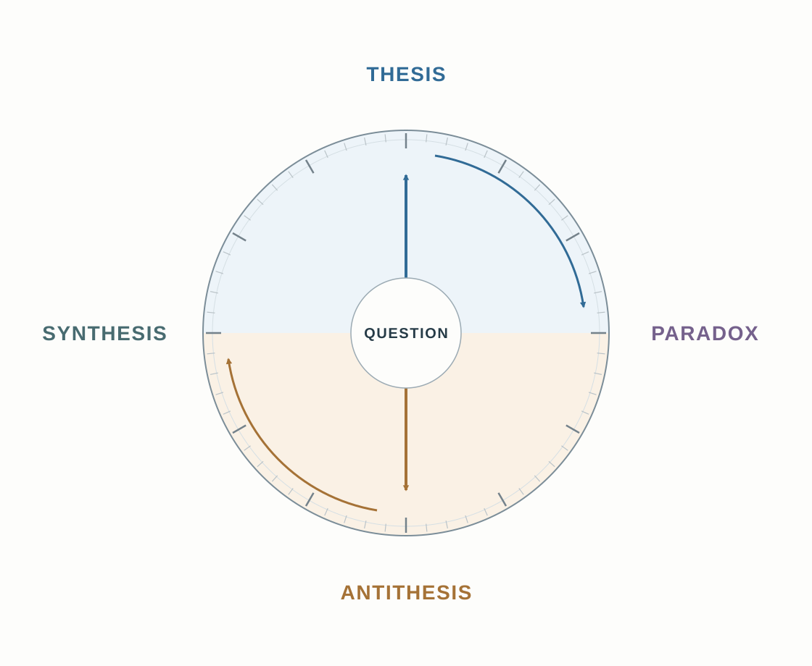
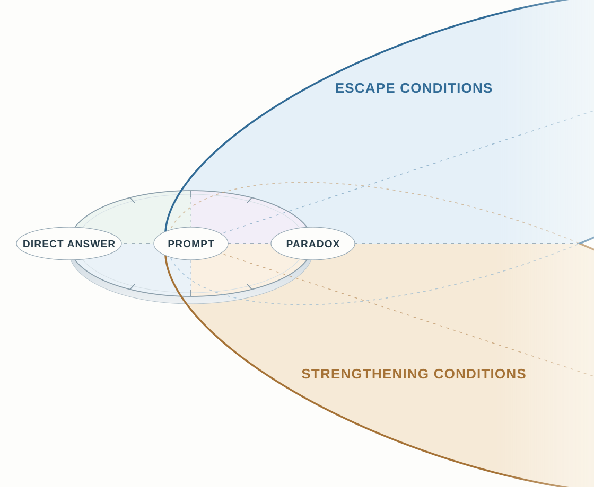

# The Circle and the Tilt

KCE gives us a way to preserve a governing relationship while changing its level of description. A stable anchor also makes another movement possible: examine the same problem from different positions without losing what the inquiry is about.

An archive holds fragile research notebooks. Readers want to study them; handling is gradually damaging the pages. Some researchers need only the words. Others need the binding, paper or marks that a reproduction may not preserve. The shared question is how to make the collection useful while keeping it available for future readers.

The circle and the tilt make possible search directions visible. The circle changes the view of a shared question. A tilt changes the terms in which its alternatives can be expressed. The archive lets us follow both movements before the following chapters give them more explicit jobs within the cognitive tools.

## 1. Keep the question at the center

Begin with a proposal: open the original notebooks to readers. A collection that cannot be studied has lost much of its purpose. From this position, restrictions look like the principal obstacle.

Across the circle, the opposing proposal also has a reason: restrict original handling. A damaged page cannot be restored simply because access was well intentioned. Unrestricted use can consume the evidence that makes future study possible.

These positions can be called **thesis** and **antithesis**. They oppose one another as proposals while addressing the same collection and the same larger question. Defending a proposal and preserving that question are different things.

*The dial keeps the question in view as the inquiry changes direction. Its labels mark possible positions rather than a required sequence.*

Other positions can introduce different opening hours, shorter appointments or stricter eligibility. They alter the amount or distribution of handling. Examining them can reveal a useful arrangement even when no more radical change is needed.

*Perspective change* brings another consequence into view. *Inversion* reverses the working presumption about original handling. *Comparison* relates the views to the opening proposal, and *salience reweighting* changes which concern receives attention. Their combination lets us move without replacing the subject each time a different consideration becomes prominent.

## 2. Recognize when the alternatives preserve the same difficulty

Suppose the inquiry repeatedly returns to one tension: the collection must be used to fulfill its purpose, yet use can consume what makes it valuable. Longer hours increase one kind of access. Shorter appointments reduce some handling. The argument still treats access as placing an original notebook in someone's hands.

This is the **paradox** position in the analogy. It names a practical tension worth retaining. The two concerns can both be reasonable without constituting a formal logical contradiction or establishing that no arrangement is possible.

The tension becomes useful when stated more precisely. What part of study requires handling, and what part of handling threatens preservation? Those questions expose the assumption that keeps the proposals on the same line between more and less original use.

*Decomposition* separates meaningful study, original handling and continued preservation. *Relation extraction* identifies how the opening arrangement makes them depend on one another. Their combination locates what another turn around the circle might leave unchanged.

A practical paradox therefore gives the next move a target: the assumption linking study to original handling. A changed frame is useful if it exposes another way to relate those requirements.

## 3. Tilt the frame by adding a consequential distinction

The useful movement now is to reconsider what counts as access.

A reader tracing changes in vocabulary may need a searchable transcription and clear page images. A researcher examining a repair to the binding needs the original object. Both seek access, but the evidence their questions require differs.

The distinction adds a dimension to the opening comparison: **the kind of research need and the form of access that can serve it**. We can now consider more than an undifferentiated increase or decrease in handling.

*Above and below show alternative outcomes of evaluation. The return path tests whether a changed relationship answers the original question.*

The earlier Prism vocabulary called this a **YZ tilt** or paradox escape. Moving beyond the opening plane exposes conditions for evaluation: a changed relationship may release the difficulty, or the same limitation may persist in another form.

Here, *label decomposition* opens the compressed word “access.” *Classification* relates each request to its evidence needs. *Dimensional lift* allows those relationships to vary independently of the total amount of handling. Together these moves make a different arrangement conceivable. Renaming the difficulty alone would leave that work undone.

## 4. Return with an arrangement that preserves the concern

A candidate arrangement becomes visible: provide reproductions for work they can adequately support, and retain supervised access to originals for questions requiring the physical object.

This is a possible **synthesis**. Its contribution is a changed division of work. It separates needs that the opening frame treated as one, while retaining preservation and meaningful study as concerns. It need not lie halfway between opening and closing the archive.

The proposal still has to answer the original question. A copy may omit a consequential mark. Creating a copy also involves handling. Supervision requires time, and a notebook may remain too fragile for a particular examination. These conditions can narrow the arrangement or leave part of the tension unresolved.

The **return path** is the connection back to meaningful study and future availability. A proposal that eliminates useful study loses one requirement. A proposal that assumes every copy is equivalent to the original loses another.

*Recombination* joins different access routes to different needs. *Concretization* asks what a particular request and evidence carrier require. *Evaluation*, including a countercase such as studying the binding, tests whether the changed arrangement still serves the concern. Their combination gives the tilt a consequence we can inspect.

Sometimes the resulting distinction supports a workable synthesis. Sometimes it identifies exactly why one need remains unmet. Both outcomes can improve the account of the problem.

## 5. Bind the analogy to the cognitive tools

The analogy becomes useful to an application designer when its movements can be related to explicit operations. The following chapters develop that division of work:

| Movement in the example | Where the tools contribute |
|---|---|
| Retain the shared question and its consequential relationships. | [KCE](08_KEY_CONCEPT_EXTRACTION.md) develops the anchor; the [Coupler](07_PRISM_COUPLER.md) binds its participants and conditions. |
| Select a turn, inversion or added distinction. | [CTR](10_COGNITIVE_TRANSFORM_REGISTRY.md) names transformations and what they must preserve. |
| Develop the arrangements the changed view permits. | [ETE](11_EXPLORATION_TRANSFORM_ENGINE.md) constructs alternatives with their dependencies and limits. |
| Examine what each arrangement actually supports. | [PSPP](12_PARALLEL_SYSTEM_COMPARISON.md) compares candidates and retains grounds for a choice or an unresolved result. |
| Revisit a particular remaining difficulty. | [CREM](../skills/CREM.md) can address conflicting relationships; [CEC](../skills/CEC.md) can examine consequential order; [DARE/IDCM](../skills/DARE.md) can inspect a frame or rejection that concealed something important. |

The full circle is not one compulsory route through these modules. A direct comparison may suffice. A difficult antithesis or paradox may make the tilt especially useful because the opening alternatives cannot yet express a needed relationship.

A bounded request can expose the movement:

> Use the circle-and-tilt analogy for the fragile notebooks. Keep meaningful study and future preservation in view. Develop the case for original access and the case for restricting handling. Identify what both positions assume about access. Consider whether different research needs require different evidence carriers, then return a possible arrangement to the original concerns. State a request it could serve and one it could leave unresolved. Use only the movements that change the inquiry.

The next chapter makes transformation choice explicit: which movement should be tried, what should it preserve, and how should its consequences be checked?

Reference: [CTR transformation definitions](../../framework/CTR_Parallax_v2.1_SplitTransformRegistry.json) · [ETE specification](../../framework/ETE_v1.1_SplitLayerExplorationTransform.json) · [historical circle-and-tilt context](../HISTORY.md#the-earlier-circle-and-tilt).

[Previous: KCE: Extracting a Reusable Concept](08_KEY_CONCEPT_EXTRACTION.md) · [Next: The Cognitive Transformation Registry](10_COGNITIVE_TRANSFORM_REGISTRY.md)
